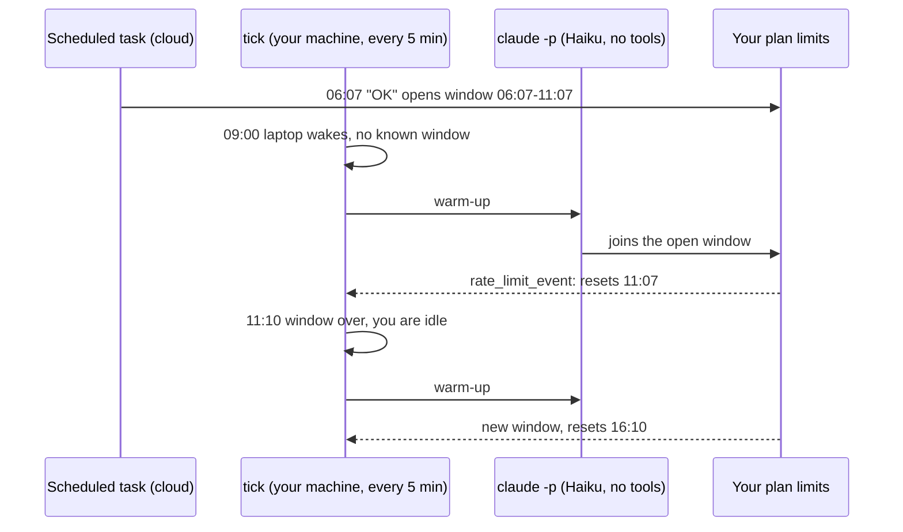

<div align="center">

# claude-limits-window-shift

**Claude's 5-hour window starts at your first message. Make it start when it helps you.**

An open source project by [Spoki](https://spoki.com).

[](https://github.com/Spoki-App/claude-limits-window-shift/actions/workflows/ci.yml)
[](https://github.com/Spoki-App/claude-limits-window-shift/releases)
[](LICENSE)


[Get started](#get-started) · [Why](#why) · [How it works](#how-it-works) · [Commands](#commands) · [Weekly limit](#the-weekly-limit) · [Security](#security-and-terms) · [FAQ](#faq)

</div>

## Get started

```sh
curl -fsSL https://github.com/Spoki-App/claude-limits-window-shift/releases/latest/download/install.sh | sh -s -- --start 09:00 --end 18:00
```

That installs the Claude Code skill, saves your workday, and runs a 5-minute scheduler on your
machine (launchd on macOS, a systemd user timer on Linux). Then add the
[cloud warm-up](#the-cloud-warm-up) once, so the first window opens even while your laptop sleeps.

Or ask Claude: *"set up limits-window-shift for my 9 to 6 workday"*.

## Why

Pro and Max plans have a usage window that **starts with your first message and lasts 5 hours**.
If your first message is at 9:00, a 9:00-18:00 day only ever sees two windows. Send one tiny
message at 06:00 instead, and three fresh windows overlap your day:

```mermaid
gantt
    dateFormat HH:mm
    axisFormat %H:%M
    section Workday
    09:00 to 18:00        :active, 09:00, 18:00
    section No warm-up
    Window 1              :09:00, 14:00
    Window 2              :14:00, 19:00
    section Warm-up at 06:00
    Window 1              :06:00, 11:00
    Window 2              :11:00, 16:00
    Window 3              :16:00, 21:00
```



If you hit the limit at 10:30, you wait 30 minutes instead of three and a half hours.
`plan` does this math for any schedule:

```text
$ window_shift.py plan --start 09:00 --end 18:00
Without a warm-up: 2 windows touch your workday
  09:00-14:00  5h00 inside your workday
  14:00-19:00  4h00 inside your workday

With a warm-up at 06:00: 3 windows touch your workday
  06:00-11:00  2h00 inside your workday
  11:00-16:00  5h00 inside your workday
  16:00-21:00  2h00 inside your workday

Any warm-up between 04:30 and 07:30 keeps 3 windows.
```

| | |
|---|---|
| **Planned** | Picks the warm-up time that gives the most windows, balanced so the first and last are equally useful. Days off and custom work days included. |
| **Cheap** | One tiny Haiku message per window, with no tools, MCP servers, settings, skills or saved session. About 3 to 4 per workday. |
| **Self-correcting** | Reads the real reset time from Claude's own rate-limit event after every warm-up, so it never guesses where a window ends. |
| **Official parts only** | The `claude` CLI you already use and Claude Code's own scheduled tasks. No API calls, no token handling. |

## How it works

1. **Planner.** From your hours it computes the best warm-up time (06:00 for 9-18), the
   resets it creates (11:00, 16:00) and the latest warm-up that still helps (07:30).
2. **The cloud warm-up.** A Claude Code scheduled task runs at 06:07 on work days and answers
   "OK". Scheduled tasks count against the same plan limits as everything else, so this opens
   the first window while your laptop is closed.
3. **The local tick.** Every 5 minutes, inside your workday, `tick` checks whether a window is
   open. If none is (you were at lunch when the 11:00 one ended, or the cloud run failed), it
   sends one warm-up and records the new reset time. If you already started a window yourself,
   the warm-up joins it and the tick learns its end. At most one warm-up per window.



The warm-up is exactly this, run from an empty folder with a clean environment:

```sh
claude -p "OK" --model haiku --system-prompt "Reply with the single word OK." --tools "" \
  --strict-mcp-config --setting-sources "" --safe-mode --disable-slash-commands \
  --no-session-persistence --max-turns 1 --output-format stream-json --verbose
```

Flags your Claude Code version doesn't know are left out. `--bare` is never used: it ignores the
subscription login, so it would not open the window.

### The cloud warm-up

`cloud-spec` prints the task to create:

```text
$ window_shift.py cloud-spec
  Schedule:   CRON_TZ=Europe/Rome 7 6 * * 1-5  (06:07 mon-fri)
  Prompt:     Reply with the single word OK. Do not use any tool.
  Model:      the smallest available (Haiku)
  Repository, tools, connectors: none
```

Create it with `/schedule` in a Claude Code session logged in to the same account (the skill
does this for you), or from the scheduled tasks page of Claude Code on the web. Then open the
task and check that no tools or connectors were added by default.

## Commands

`window_shift.py` lives in `claude/skills/limits-window-shift/`. Run it with `python3 -I`.

| Command | What it does |
|---|---|
| `plan` | Best warm-up time for `--start`/`--end` (and `--days`, `--margin`, `--not-before`) |
| `setup` | Saves the workday, timezone, days off (`--skip-date`) and Claude profiles (`--profile`, `--config-dir`) |
| `install` | Runs `tick` every 5 minutes (launchd or systemd user timer) |
| `uninstall` | Removes the scheduler |
| `cloud-spec` | The cloud scheduled task to create (`--json` for exact fields) |
| `status` | Open window, next action, last warm-up, weekly usage and pace, per profile |
| `warm` | Sends one warm-up now |
| `tick` | What the scheduler runs (`--dry-run --now 2026-11-19T06:05` to simulate) |
| `doctor` | Checks Python, the `claude` CLI, its flags, each profile's login and the scheduler |
| `version` | Prints the version and checks for a newer release |

Several Claude accounts on one machine (different `CLAUDE_CONFIG_DIR`s) are supported: each
profile has its own state, and each account needs its own cloud task.

Config lives in `~/.config/claude-limits-window-shift/` (`chmod 600`, override with
`CLWS_CONFIG`), next to the per-profile state and a small `log.jsonl`.

## The weekly limit

The weekly limit **cannot be moved**. Anthropic's help center says it resets at a fixed time each
week assigned to your account, whatever you do. So this tool does not try. It shows you where you
stand instead:

```text
weekly: 41% used, resets Thu 22:00, 2 workdays left, about 30% per workday
```

It also keeps the last weekly reset times it observed. If they ever stop being exactly a week
apart, `status` says so: that would mean the weekly window is rolling again, and anchoring it to
a Monday morning would become possible.

## Security and terms

- **No credentials touched.** The tool runs the `claude` binary with your existing login. It
  never reads tokens, keychain entries or credential files, and never calls Anthropic endpoints
  itself.
- **Clean environment.** Warm-ups run with an allowlisted environment, from an empty folder,
  with tools, MCP servers, settings, hooks and plugins off.
- **Small footprint.** Haiku, a one-word answer, at most one per window, never retried after a
  limit is reached.
- **Your call.** Anthropic's terms allow automated use of Claude Code through its documented
  headless mode and scheduled tasks; limits "assume ordinary, individual usage". This tool
  doesn't add usage, it only chooses when your windows start. Read the terms for your plan and
  decide for yourself.

Found a vulnerability? See [SECURITY.md](SECURITY.md).

## Status

Verified on 2026-11-18 with Claude Code 2.1.303.

| Fact | Source |
|---|---|
| The 5-hour window starts with your first message and is shared by claude.ai, Desktop and Claude Code | [Usage and length limits](https://support.claude.com/en/articles/11647753-usage-and-length-limits) |
| The weekly reset is fixed per account | same article |
| Scheduled tasks draw from the same plan limits | [Claude Code docs: scheduled tasks](https://code.claude.com/docs/en/routines.md) |
| `rate_limit_event` carries `resetsAt` and `utilization` in headless stream-json | [Agent SDK reference](https://code.claude.com/docs/en/agent-sdk/typescript.md) |
| `--bare` never reads the subscription login | [Headless mode](https://code.claude.com/docs/en/headless.md) |
| A window start is not rounded to the hour (community measurements) | the tool reads `resetsAt` instead of assuming |

Plans without a 5-hour limit don't need this tool: `status` will never see a 5-hour window.

## FAQ

<details>
<summary>Does the warm-up eat my budget?</summary>

A few hundred tokens of Haiku per window. Compared to a working session, it is noise.
`status` shows the tokens the last warm-up used.
</details>

<details>
<summary>My laptop is closed at 6:00. Do I need the cloud task?</summary>

Yes, for the early window. launchd does not run jobs while a closed Mac sleeps; it runs them
when it wakes. The local tick handles the resets during the day, when your machine is on.
</details>

<details>
<summary>What if the cloud task runs late?</summary>

Anything before 07:30 (for a 9-18 day) still gives three windows. The planner prints that
latest useful time, and `cloud-spec` never schedules past it.
</details>

<details>
<summary>I already wrote to Claude before the reset. Will the tick start a second window?</summary>

No. A message inside an open window doesn't open a new one: the warm-up joins your window and
the tick reads its real end time.
</details>

<details>
<summary>It says "logged out".</summary>

The CLI login for that profile expired. Run the `claude auth login` command `doctor` prints. On
macOS the tick also shows a notification, once a day.
</details>

## License

[MIT](LICENSE). Not affiliated with or endorsed by Anthropic. Claude and Claude Code are
trademarks of Anthropic.

<div align="center">

If this gave you back a few hours of Claude, a star helps others find it.

</div>
