<div align="center">

# claude-limits-window-shift

### Hit your Claude limit at 10:30? Wait 30 minutes, not 3 and a half hours.

Claude's 5-hour window starts with your first message.<br>
This starts it for you, before your day begins.

[](https://github.com/Spoki-App/claude-limits-window-shift/actions/workflows/ci.yml)
[](https://github.com/Spoki-App/claude-limits-window-shift/releases)
[](LICENSE)


An open source project by [Spoki](https://spoki.com).

</div>

## Set it up with one message

Paste this into Claude Code, with your own hours:

```text
Set up claude-limits-window-shift by following https://raw.githubusercontent.com/Spoki-App/claude-limits-window-shift/main/SETUP.md (install it, start its scheduler, create its daily cloud task). I work 9-18, Monday to Friday.
```

That's it. Claude sets everything up and tells you your new windows.

## What changes

```mermaid
gantt
    dateFormat HH:mm
    axisFormat %H:%M
    section Your day
    Work                  :active, 09:00, 18:00
    section Before
    Window 1              :09:00, 14:00
    Window 2              :14:00, 19:00
    section After
    Window 1              :06:00, 11:00
    Window 2              :11:00, 16:00
    Window 3              :16:00, 21:00
```



| A 9-to-6 day | Before | After |
|---|---|---|
| Fresh 5-hour windows during work | 2 | **3** |
| Limit hit at 10:30, back at | 14:00 | **11:00** |
| Things you have to remember | some | **none** |

## Why you'll like it

- **One message.** No config files, no cron, no terminal gymnastics.
- **Runs while you sleep.** A tiny "OK" at 6 a.m. from Claude's own scheduled tasks, even with your laptop closed.
- **Smart.** It works out the best time from your hours, follows the real reset times, and skips weekends and days off.
- **Practically free.** About 600 tokens of Haiku per window. Noise.
- **Safe.** Only Claude's own tools. Your login never leaves Claude Code.

## Just ask Claude

Once it's set up, talk to it like a colleague:

- *"How are my Claude limits?"*
- *"From now on I start at 8."*
- *"I'm off on Friday."*
- *"Remove it."*

## Good to know

<details>
<summary>Can it move my weekly limit too?</summary>

No. Anthropic resets the weekly limit at a fixed time for each account. It does show you how much
you've used and how much you can spend per remaining workday, so the end of the week holds no surprises.
</details>

<details>
<summary>Is this allowed?</summary>

It uses only official pieces: the `claude` CLI you already have and Claude Code's scheduled
tasks. It doesn't add usage, it only chooses when your windows start. Read the terms of your plan
and decide for yourself.
</details>

<details>
<summary>Which plans does it help?</summary>

Any plan with a 5-hour window: Pro, Max and Team. macOS or Linux, with Claude Code installed.
</details>

<details>
<summary>How do I remove it?</summary>

Tell Claude *"remove claude-limits-window-shift"*.
</details>

Curious about the details? Read [how it works](docs/how-it-works.md).

## License

[MIT](LICENSE). Not affiliated with or endorsed by Anthropic. Claude and Claude Code are
trademarks of Anthropic.

<div align="center">

If this gave you back a few hours of Claude, a ⭐ helps others find it.

</div>
