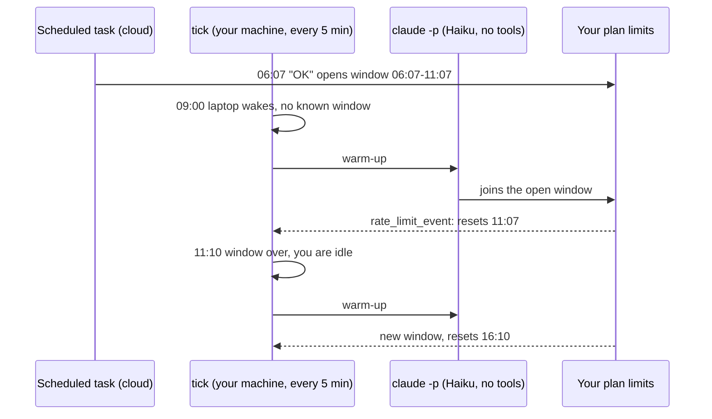

# How it works

The technical side of [claude-limits-window-shift](../README.md): what runs, when, and why it is safe.

## The three parts

1. **Planner.** From your hours it computes the best warm-up time (06:00 for 9-18), the
   resets it creates (11:00, 16:00) and the latest warm-up that still helps (07:30). It picks
   the time that gives the most 5-hour windows inside your workday, balanced so the first and
   last are equally useful.
2. **The cloud warm-up.** A Claude Code scheduled task runs at 06:07 on work days and answers
   "OK". Scheduled tasks count against the same plan limits as everything else, so this opens
   the first window while your laptop is closed.
3. **The local tick.** Every 5 minutes, inside your workday, `tick` checks whether a window is
   open. If none is (you were at lunch when the 11:00 one ended, or the cloud run failed), it
   sends one warm-up and records the new reset time. If you already started a window yourself,
   the warm-up joins it and the tick learns its end. At most one warm-up per window.



`plan` shows the math for any schedule:

```text
$ window_shift.py plan --start 09:00 --end 18:00
Without a warm-up: 2 windows touch your workday
  09:00-14:00  5h00 inside your workday
  14:00-19:00  4h00 inside your workday

With a warm-up at 06:00: 3 windows touch your workday
  06:00-11:00  2h00 inside your workday
  11:00-16:00  5h00 inside your workday
  16:00-21:00  2h00 inside your workday

Any warm-up between 04:30 and 07:30 keeps 3 windows.
```

## The warm-up

Exactly this, run from an empty folder with an allowlisted environment:

```sh
claude -p "OK" --model haiku --system-prompt "Reply with the single word OK." --tools "" \
  --strict-mcp-config --setting-sources "" --safe-mode --disable-slash-commands \
  --no-session-persistence --max-turns 1 --output-format stream-json --verbose
```

It costs about 600 tokens. The reset times come from the `rate_limit_event` in the stream, so
the tool never guesses where a window ends. Flags your Claude Code version doesn't know are left
out. `--bare` is never used: it ignores the subscription login, so it would not open the window.

## The cloud task

`cloud-spec` prints the task to create (`--json` gives the complete routine body):

```text
$ window_shift.py cloud-spec
  Schedule:   CRON_TZ=Europe/Rome 7 6 * * 1-5  (06:07 mon-fri)
  Prompt:     Reply with the single word OK. Do not use any tool.
  Model:      the smallest available (Haiku)
  Tools:      Read only (an empty list is replaced by the full default set)
  Repository, connectors: none
```

The one-message setup creates it for you with `/schedule`. By hand: the scheduled tasks page of
Claude Code on the web, from the same account. Then check its tools and connectors: a task
created with no tools gets the full default set, and one created without an explicit "no
connectors" gets all of yours.

## Install by hand

```sh
curl -fsSL https://github.com/Spoki-App/claude-limits-window-shift/releases/latest/download/install.sh | sh -s -- --start 09:00 --end 18:00
```

It installs the Claude Code skill, saves your workday and runs the 5-minute scheduler (launchd on
macOS, a systemd user timer on Linux). Then create the cloud task above. The full runbook Claude
follows is [SETUP.md](../SETUP.md).

## Commands

`window_shift.py` lives in `claude/skills/limits-window-shift/`. Run it with `python3 -I`.

| Command | What it does |
|---|---|
| `plan` | Best warm-up time for `--start`/`--end` (and `--days`, `--margin`, `--not-before`) |
| `setup` | Saves the workday, timezone, days off (`--skip-date`) and Claude profiles (`--profile`, `--config-dir`) |
| `install` | Runs `tick` every 5 minutes (launchd or systemd user timer) |
| `uninstall` | Removes the scheduler |
| `cloud-spec` | The cloud scheduled task to create (`--json` for the routine body) |
| `status` | Open window, next action, last warm-up, weekly usage and pace, per profile |
| `warm` | Sends one warm-up now |
| `tick` | What the scheduler runs (`--dry-run --now 2026-11-19T06:05` to simulate) |
| `doctor` | Checks Python, the `claude` CLI, its flags, each profile's login and the scheduler |
| `version` | Prints the version and checks for a newer release |

Several Claude accounts on one machine (different `CLAUDE_CONFIG_DIR`s) are supported: each
profile has its own state, and each account needs its own cloud task. Config lives in
`~/.config/claude-limits-window-shift/` (`chmod 600`, override with `CLWS_CONFIG`), next to the
per-profile state and a small `log.jsonl`.

## The weekly limit

Anthropic's help center says the weekly limit resets at a fixed time each week assigned to your
account, whatever you do, so the tool does not try to move it. `status` shows where you stand:

```text
weekly: 41% used, resets Thu 22:00, 2 workdays left, about 30% per workday
```

It also keeps the last weekly reset times it observed. If they ever stop being exactly a week
apart, `status` says so: that would mean the weekly window is rolling again.

## Security and terms

- **No credentials touched.** The tool runs the `claude` binary with your existing login. It
  never reads tokens, keychain entries or credential files, and never calls Anthropic endpoints.
- **Clean environment.** Warm-ups run with an allowlisted environment, from an empty folder,
  with tools, MCP servers, settings, hooks and plugins off.
- **Small footprint.** Haiku, a one-word answer, at most one per window, never retried after a
  limit is reached.
- **Your call.** Anthropic's terms allow automated use of Claude Code through its documented
  headless mode and scheduled tasks; limits "assume ordinary, individual usage". The tool doesn't
  add usage, it only chooses when your windows start. Read the terms for your plan.

Found a vulnerability? See [SECURITY.md](../SECURITY.md).

## Sources

Verified on 2026-11-18 with Claude Code 2.1.303.

| Fact | Source |
|---|---|
| The 5-hour window starts with your first message and is shared by claude.ai, Desktop and Claude Code | [Usage and length limits](https://support.claude.com/en/articles/11647753-usage-and-length-limits) |
| The weekly reset is fixed per account | same article |
| Scheduled tasks draw from the same plan limits | [Claude Code docs: scheduled tasks](https://code.claude.com/docs/en/routines.md) |
| `rate_limit_event` carries `resetsAt` and `utilization` in headless stream-json | [Agent SDK reference](https://code.claude.com/docs/en/agent-sdk/typescript.md) |
| `--bare` never reads the subscription login | [Headless mode](https://code.claude.com/docs/en/headless.md) |
| A window start is not rounded to the hour (community measurements) | the tool reads `resetsAt` instead of assuming |
| One warm-up costs about 600 tokens and returns both windows in `unifiedWindows` | measured, see `tests/test_warmup.py` |

Plans without a 5-hour limit don't need this tool: `status` will never see a 5-hour window.
